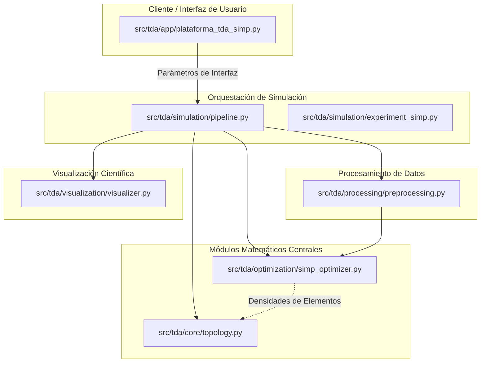

# TDA-SIMP: Framework de Análisis Topológico de Datos aplicado a la Optimización Estructural

Este repositorio implementa un marco metodológico y computacional que unifica el **Análisis Topológico de Datos (TDA)** y la **Optimización Estructural** a través del método **SIMP** (Solid Isotropic Material with Penalization). Desarrollado bajo un paradigma cuantitativo y positivista, el framework permite estudiar la evolución de invariantes topológicos en procesos de optimización y analizar la robustez y estabilidad de descriptores algebraico-topológicos frente al ruido.

---

## 1. Contexto y Problema Científico

En la ingeniería de diseño estructural y de análisis de datos de alta dimensión, los métodos tradicionales basados puramente en geometría euclidiana y análisis infinitesimal local presentan limitaciones fundamentales:
* **Falta de Control Topológico:** Métodos numéricos como SIMP son altamente efectivos para reducir la *compliance* global distribuyendo material de forma óptima bajo restricciones de volumen. Sin embargo, carecen de control directo sobre los invariantes topológicos (como el número de Betti $\beta_1$, que describe el número de agujeros independientes). Esto genera topologías complejas, difíciles de manufacturar debido a micro-vacíos o agujeros no intencionales.
* **Desacoplamiento Metodológico:** La caracterización de la forma de las estructuras y el análisis de estabilidad ante ruido en nubes de puntos de sensores se han tratado tradicionalmente de forma aislada.

Existe un vacío metodológico en la integración de descriptores algebraicos estables derivados de la **homología persistente** para regularizar o auditar de forma sistemática el proceso de convergencia de optimizadores estructurales. Este proyecto aborda dicha brecha, implementando un pipeline integrado en el que la homología persistente actúa como métrica de control de calidad y complejidad topológica *post hoc* sobre los diseños resultantes del algoritmo SIMP.

---

## 2. Hipótesis de Investigación

El desarrollo de este framework está guiado por dos hipótesis específicas de investigación, formuladas operacionalmente sobre métricas cuantificables de rendimiento:

* **H.E.1 — Estabilidad en Análisis Topológico de Datos (TDA):**
  La homología persistente, computada sobre nubes de puntos $X \subset \mathbb{R}^d$ ($d \le 100$) mediante filtraciones de Vietoris-Rips utilizando `Ripser 0.6`, proporciona números de Betti $\beta_0$ (componentes conexas) y $\beta_1$ (ciclos 1-dimensionales) que permanecen estables bajo perturbaciones de ruido gaussiano de magnitud entre el $15\%$ y $20\%$ del diámetro del conjunto de datos. Esta estabilidad supera a la de descriptores geométricos clásicos en tareas de caracterización de formas bajo ruido.

* **H.E.2 — Eficiencia y Convergencia en Optimización Estructural (SIMP):**
  El método SIMP formulado con un factor de penalización $p = 3$ y una fracción de volumen objetivo $f_V = 0.5$ converge a una distribución óptima de densidades que reduce la *compliance* global en al menos un $40\%$ en comparación con el diseño uniforme de igual volumen (H.E.2a; el bloque sólido no es un referente válido por conservación de la materia). El número de Betti $\beta_1(\Omega_{\text{sólido}})$ del diseño convergido resulta invariante frente a la resolución de malla, el factor de penalización $p \in \{2,3,4\}$ y el radio del filtro $r_{\min} \in [1.5, 4.0]$ (H.E.2b).

---

## 3. Arquitectura del Sistema

La arquitectura sigue un diseño modular y desacoplado, estructurado de la siguiente forma:



---

## 4. Estructura del Repositorio

El repositorio está organizado como un paquete de Python instalable. A continuación se detallan las responsabilidades de cada directorio y archivo clave:

```text
EstructuraTopologica/
├── LICENSE                      # Licencia BSD-3-Clause
├── setup.py                     # Archivo de configuración para la instalación del paquete
├── requirements.txt             # Dependencias directas (numpy, pandas, matplotlib, scipy,
│                                # scikit-learn, streamlit, plotly, gudhi, kaleido + ripser aparte)
├── install_package.sh           # Instalación automatizada con uv para Linux/macOS
├── install_package.bat          # Instalación automatizada para Windows
├── README.md                    # Este archivo de documentación central
├── docs/                        # Documentación técnica y manual de usuario (.docx)
└── src/
    └── tda/
        ├── __init__.py              # Inicialización del namespace tda
        ├── analysis/                # Análisis topológico y métricas de validación
        │   ├── __init__.py
        │   ├── metrics.py           # Exactitud de K-Means y verificación de números de Betti
        │   └── stability.py         # Barrido de ruido gaussiano para validar H.E.1
        ├── app/                     # Interfaz de usuario (Streamlit)
        │   ├── __init__.py
        │   ├── plataforma_tda_simp.py  # Landing page: Plataforma TDA-SIMP
        │   ├── theme.py              # Tema visual, estilos y funciones de UI
        │   ├── download_utils.py     # Utilidades de exportacion y configuracion .exe
        │   └── pages/
        │       ├── __init__.py
        │       ├── 1_H.E.1_Robustez_TDA_vs_Euclidianos.py  # H.E.1: Robustez TDA vs Euclidianos
        │       ├── 2_H.E.2_Optimizacion_SIMP_Metrica_Compuesta.py  # H.E.2: Optimizacion SIMP
        │       └── 4_Ejemplo_Viga_1D_vs_2D.py  # Ejemplo: Viga 1D vs 2D con load cases y STL
        ├── core/                    # Núcleo matemático
        │   ├── __init__.py
        │   ├── fem.py               # Motor FEM Q4: ensamble, solver, sensibilidades, OC
        │   └── topology.py          # Homología persistente, filtraciones y números de Betti
        ├── optimization/            # Optimización estructural SIMP
        │   ├── __init__.py
        │   ├── beam_optimizer.py    # Optimización de viga con MDF + SIMP (sin matplotlib)
        │   ├── metric_simp.py       # Algoritmo 1 completo: preprocesado → SIMP → TDA
        │   └── simp_optimizer.py    # Motor FEM y optimizador estructural SIMP 2D
        ├── processing/              # Preprocesamiento de datos
        │   ├── __init__.py
        │   ├── preprocessing.py     # Ruido gaussiano, normalización y preparación de datos
        │   └── sampling.py          # Muestreo sintético: esfera, toro, ruido controlado
        ├── simulation/              # Orquestación de experimentos
        │   ├── __init__.py
        │   ├── experiment_simp.py   # Experimento headless para validar H.E.2 (SIMP)
        │   └── pipeline.py          # Pipeline unificado de ejecución secuencial
        └── visualization/           # Visualización científica
            ├── __init__.py
            ├── figuras.py           # E3: reconstrucción headless de Figs. 5.1–5.7 desde datos/CSV
            ├── plots_tda.py         # Figuras Plotly listas para Streamlit/exportación
            └── visualizer.py        # Graficadores de diagramas de persistencia, barcodes y mallas
```

---

## 5. Instrucciones de Instalación

Se recomienda el uso de **[uv](https://docs.astral.sh/uv/)** como gestor de paquetes y entornos (rápido, compatible con `pip` y `requirements.txt`). El proyecto incluye scripts automatizados para Linux/macOS y Windows, o podés seguir los pasos manuales.

### Requisitos del Sistema

* **Sistema Operativo:** Linux / macOS / Windows
* **Python:** 3.10 o superior (entorno validado en Python 3.12)
* **Gestor de paquetes:** `uv` ([instalación](https://docs.astral.sh/uv/getting-started/installation/))

### Método rápido — Script automatizado

**Linux / macOS:**

```bash
# Opción 1: Clonar y ejecutar el script
git clone <repo-url> && cd EstructuraTopologica
bash install_package.sh
```

El script verifica `uv`, crea el entorno virtual en `.venv/`, instala las dependencias, instala `ripser` con `--no-deps` (evita su dependencia problemática `persim`, sin wheels para Windows) y te pregunta si querés ejecutar la app.

**Windows:**

```
# Haz doble clic en install_package.bat o ejecutá desde cmd:
install_package.bat
```

### Método manual — paso a paso (con uv)

```bash
# 1. Crear el entorno virtual
uv venv .venv

# 2. Instalar dependencias
uv pip install -r requirements.txt

# 3. Instalar ripser sin dependencias problemáticas
uv pip install ripser --no-deps

# 4. Instalar paquete local (para imports from tda.*)
uv pip install -e .

# 5. Verificar instalación
uv run python --version
uv run pip check    # Verifica que no haya conflictos
```

> **Nota:** `requirements.txt` declara las dependencias directas (9 + `ripser` aparte) con versiones flexibles (`>=`). Es la fuente única de verdad de las dependencias.

> **Nota (exportación de gráficos):** la descarga de figuras Plotly como PNG usa `kaleido`, que requiere Google Chrome. Si el export falla, ejecutá `.venv/bin/plotly_get_chrome` (descarga Chrome automáticamente).

### Verificación de la instalación

```bash
# Parado en la raíz del proyecto, con el venv activado:
python -c "import tda; print(tda.__file__)"  # Verifica que el paquete se encuentra
pip check                                       # Verifica que no haya conflictos
```

---

## 6. Instrucciones de Uso

El framework soporta dos modos de ejecución: por línea de comandos (headless) para simulaciones y procesamiento batch, y mediante una aplicación web interactiva en Streamlit.

### Modo 1: Ejecución Headless (Línea de Comandos)

Para ejecutar el pipeline principal y reproducir de forma automática los experimentos y simulaciones definidos en el marco de investigación:

```bash
# Con uv (sin activar nada):
uv run python -m tda.simulation.pipeline

# 0 con el venv activado:
source .venv/bin/activate      # Linux/macOS
python -m tda.simulation.pipeline
```

Esto procesará la optimización de una viga en voladizo (cantilever beam), generará los archivos de datos correspondientes en el directorio de salida y computará los números de Betti y diagramas de persistencia de la topología final obtenida.

### Modo 2: Plataforma TDA-SIMP en Streamlit

Para iniciar la plataforma interactiva:

```bash
# Con uv (sin activar nada):
uv run streamlit run src/tda/app/plataforma_tda_simp.py

# 0 con el venv activado:
streamlit run src/tda/app/plataforma_tda_simp.py
```

Una vez ejecutado, abra el navegador web en la direccion indicada por la consola (usualmente `http://localhost:8501`). La interfaz interactiva contiene 3 módulos:

1. **H.E.1 — Robustez TDA vs Euclidianos:** Genera nubes de puntos sintéticas (esfera, toro) con ruido gaussiano, ejecuta K-Means y valida la estabilidad de invariantes topológicos ($\beta_0$, $\beta_1$) frente a descriptores euclidianos. Incluye Figura 5.1 (calibración de $\tau$), Figura 5.2(a) (tasa de acierto de $\beta_k$), Figura 5.2(b) (cota réplica por réplica), Figura 5.3 (cota $2q$ por nivel de ruido), test de McNemar, Tabla 5.5 del Caso 1 y estimación de q*.

2. **H.E.2 — Optimización SIMP:** Optimización topológica 2D con SIMP y evaluación topológica *post hoc* del diseño resultante ($\beta_0$, $\beta_1$), con barrido multi-configuración ($r_{\min}$, $p$, malla). Valida H.E.2a (reducción ≥40% vs uniforme) y H.E.2b ($\beta_1$ invariante). Incluye Figuras 5.4–5.7 con sus datos, Tabla 5.6 dinámica y doble cómputo de Betti (característica de Euler $\chi$ vs GUDHI).

3. **Ejemplo Viga 1D vs 2D:** Laboratorio interactivo con 3 modos de carga (Voladizo-Puntual, Articulado-Central, Voladizo-Distribuida), optimizacion analitica 1D, SIMP 2D con animacion, barrido de penalizacion, comparacion lado a lado y exportacion STL del diseno binario.

### Modo 3: Reconstrucción headless de figuras (entregable E3)

Genera las figuras 5.1–5.7 del Cap. V **sin Streamlit**, por script, desde los
protocolos o CSV, con los ejes y escalas del documento (salida en `data/figuras/`):

```bash
# Caso 1 (TDA): calibración, tasa de acierto, cota por réplica y cota 2q
uv run python -m tda.visualization.figuras --protocolo he1 --n 400 --R 100

# Caso 2 (SIMP): diseño, historial, penalización, malla y umbral
uv run python -m tda.visualization.figuras --protocolo he2 --malla 60x30

# Ambos casos
uv run python -m tda.visualization.figuras --todos
```

> **Citación:** Si utilizás este framework en publicaciones académicas, por favor referenciá el repositorio y el proyecto de investigación asociado, disponible en la documentación del repositorio.
